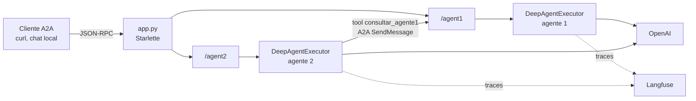
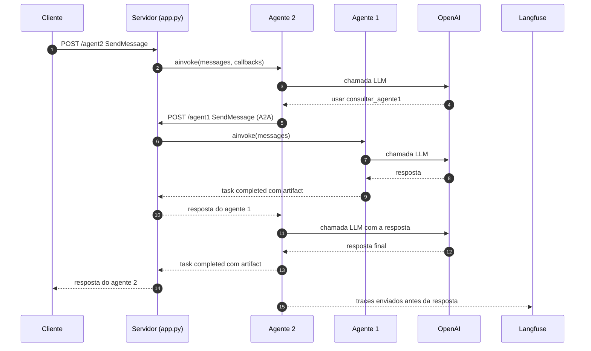
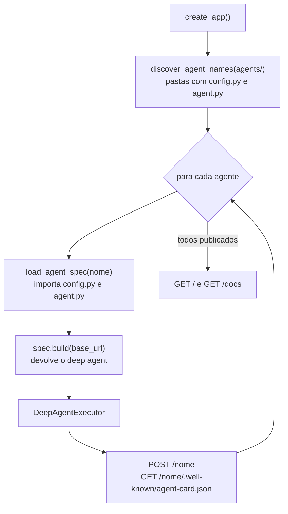
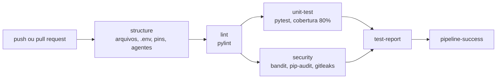

# A2A agents server


One HTTP application that serves every agent in the `agents/` folder over the
[A2A protocol](https://a2aproject.github.io/A2A/). Each agent is a deep agent
(`deepagents`) that uses OpenAI models, and agents can call each other over A2A.

## Overview



A larger architecture diagram, in Excalidraw, is in
[`docs/architecture.excalidraw`](docs/architecture.excalidraw). Open it at
[excalidraw.com](https://excalidraw.com) with **Open**, or with the Excalidraw
extension in VS Code.

## Request flow

The sequence below shows what happens when a client asks agent 2 a question
that needs agent 1.



## How agents are discovered

Each folder in `agents/` becomes a route. Adding an agent needs no change in
the server code.



## Routes

| Method and path | Description |
| --- | --- |
| `GET /` | Lists the agents and their routes as JSON. |
| `GET /docs` | Documentation page with the endpoints, skills and an example `curl` for each agent. Open it at `http://localhost:8000/docs`. |
| `GET /<agent>/.well-known/agent-card.json` | AgentCard of the agent. |
| `POST /<agent>` | A2A JSON-RPC endpoint (`SendMessage`, `GetTask`, `CancelTask`). |

The current agents are `agent1` and `agent2`. Agent 2 calls agent 1 through
the `consultar_agente1` tool.

## Layout

```
a2a_server/
  app.py                 entrypoint: `app` for Vercel and uvicorn
  agents/                one folder per agent (see agents/README.md)
    agent1/  config.py, agent.py
    agent2/  config.py, agent.py
  server/                generic code
    registry.py          finds and loads the agent folders
    app_factory.py       builds the Starlette app and the routes
    executor.py          runs each request through a deep agent
    a2a_client.py        A2A client used by agents to call other agents
    agent_card.py        builds the AgentCard
    tracing.py           Langfuse callbacks and flush
    settings.py          environment and public base URL
  tests/                 pytest suite, mirrors server/ and agents/
  docs/                  architecture diagram (Excalidraw)
  vercel.json            maxDuration for app.py
  .python-version        Python 3.13 for Vercel
  .vercelignore          files not sent to Vercel
  .pylintrc              pylint settings
  .github/workflows/     CI pipeline
  requirements.txt       runtime dependencies
  requirements-dev.txt   runtime dependencies plus the development tools
```

## Environment variables

| Variable | Required | Description |
| --- | --- | --- |
| `OPENAI_API_KEY` | yes | Key used by the OpenAI models. Read from `.env` locally. |
| `PUBLIC_BASE_URL` | no | Public base URL written into the agent cards and used by agent 2 to call agent 1. Defaults to `https://$VERCEL_URL` on Vercel and `http://127.0.0.1:8000` locally. |
| `LANGFUSE_PUBLIC_KEY` | no | Public key of the Langfuse project. Tracing is enabled only when this and the secret key are set. |
| `LANGFUSE_SECRET_KEY` | no | Secret key of the Langfuse project. |
| `LANGFUSE_HOST` | no | Langfuse host, for example `https://cloud.langfuse.com`. |

The `.env` file stays on your machine. On Vercel, set the variables in the
project settings.

## Tracing with Langfuse

When the Langfuse keys are set, every agent run is sent to Langfuse with its
LLM calls, tool calls and token usage. Each trace is named after the agent
route (for example `agent1`) and carries the A2A task id in its metadata.

- Without the keys, the agents run normally and no trace is sent.
- The traces are flushed before each answer is returned, which matters on
  Vercel because the function can stop right after responding.
- Failures to send traces are logged and do not affect the answer.
- The tracing code lives in `server/tracing.py`. The executor in
  `server/executor.py` attaches the callbacks to each run.

## Run locally

Create the environment once, from this folder:

```powershell
uv venv .venv --python 3.13
uv pip install --python .venv\Scripts\python.exe -r requirements-dev.txt
```

Start the server:

```powershell
.venv\Scripts\python.exe app.py
```

Check the routes:

```powershell
curl http://127.0.0.1:8000/
curl http://127.0.0.1:8000/agent1/.well-known/agent-card.json
```

Ask agent 2 a question (it calls agent 1 internally):

```powershell
.venv\Scripts\python.exe -c "import asyncio; from server.a2a_client import ask_agent; print(asyncio.run(ask_agent('http://127.0.0.1:8000/agent2', 'Qual e a capital da Franca?')))"
```

## Tests

```powershell
.venv\Scripts\python.exe -m pytest -q tests
```

The tests do not call the OpenAI API and do not send traces to Langfuse. A
fixture in `tests/conftest.py` removes the Langfuse keys and skips the `.env`
file for every test.

Lint, coverage and security checks, run the same way as in CI:

```powershell
.venv\Scripts\python.exe -m pylint server agents app.py tests
.venv\Scripts\python.exe -m pytest -q tests --cov=server --cov=agents --cov-fail-under=80
.venv\Scripts\python.exe -m bandit -r server agents app.py -ll
.venv\Scripts\python.exe -m pip_audit -r requirements.txt
```

Pylint settings are in `.pylintrc`.

## Continuous integration

`.github/workflows/ci.yml` runs on every push and pull request.



| Job | Checks |
| --- | --- |
| `structure` | Required files, `.env` ignored and not tracked, Vercel config, pinned dependencies, every agent folder has `config.py`, `agent.py` and `tests/agents/test_<name>.py`. |
| `lint` | pylint on `server`, `agents`, `app.py` and `tests`. |
| `unit-test` | pytest with coverage of at least 80%. Uploads the JUnit and coverage reports. |
| `security` | bandit on the application code, pip-audit on `requirements.txt`, gitleaks on the git history. |
| `test-report` | Job summary table. |
| `pipeline-success` | Fails if any required job did not succeed. |

## Deploy on Vercel

The app is deployed as a Python function. Vercel finds `app.py` and the
variable `app` automatically, and reads the dependencies from
`requirements.txt`.

1. Install the Vercel CLI and log in: `vercel login`.
2. In the project folder, run `vercel` for a preview, or `vercel --prod`.
3. In the Vercel dashboard, add `OPENAI_API_KEY` to the environment variables
   of the project. Add the Langfuse variables too, if you want tracing.
4. Open `https://<project>.vercel.app/` to check the agent index.

### Limits to keep in mind

- **Duration:** `vercel.json` sets `maxDuration` to 300 seconds, the limit on
  the Hobby plan. A request to agent 2 makes two LLM chains, so long questions
  can time out on this plan.
- **Memory:** tasks are kept in memory. On Vercel, a later request can run on
  another instance, so `GetTask` and `CancelTask` for a task created earlier
  may fail. Persistent storage is the next step if this matters.
- **Size:** the bundle must stay under 500 MB uncompressed.
- **Protection:** a deployment with Vercel Authentication enabled answers
  external clients with a login page, so they cannot call the agents.
